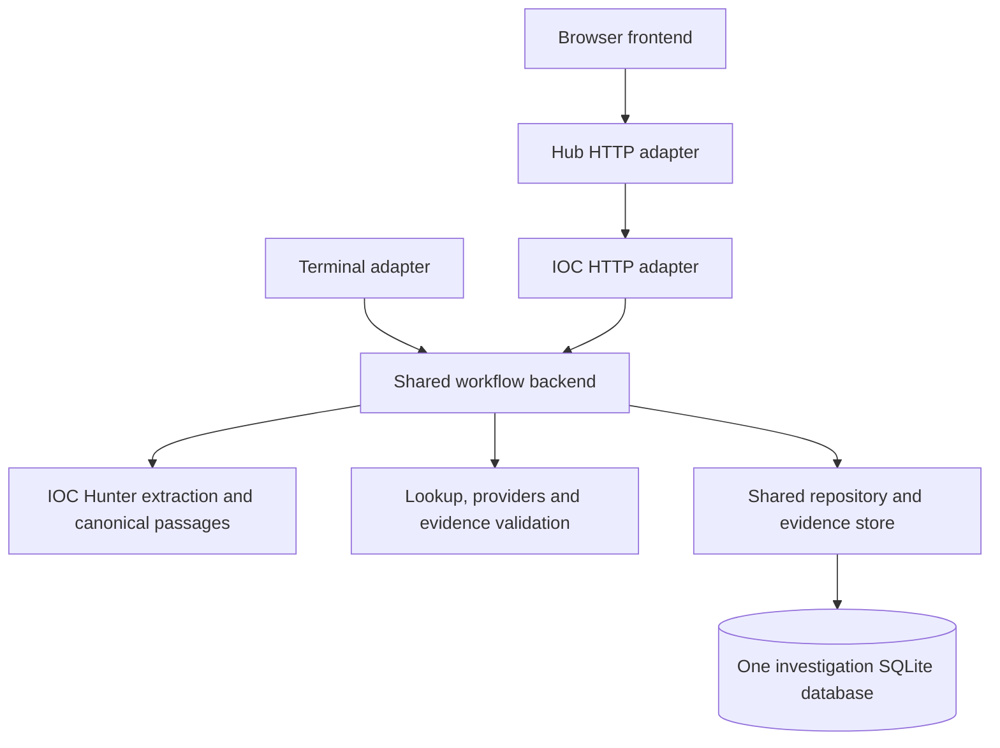
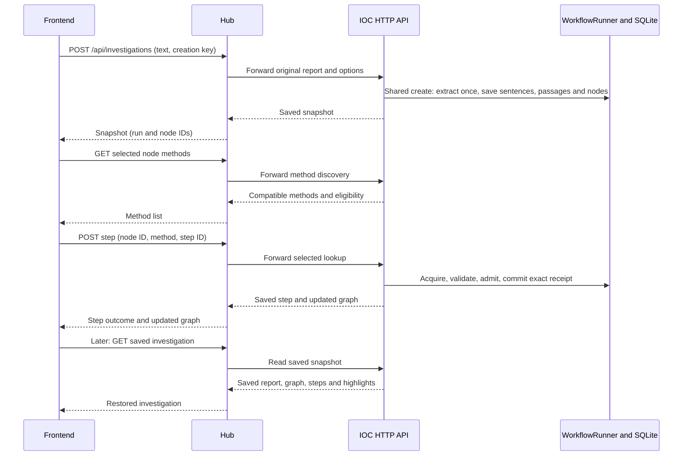

# Saved investigation API design

Status: implementation reference, updated 7 November 2026. The investigation
routes and shared application service are implemented; see [API_GUIDE.md](API_GUIDE.md)
for setup, code organization and current boundaries. User identity is pluggable;
account management and authentication verification remain separate future work.
This document specifies the backend API needed to expose the existing manual
terminal workflow through the Hub and frontend. It does not change admission
policy, add automatic Algorithm 1 selection, or implement the frontend.

## Core design principle

**One investigation workflow, one durable database, multiple access interfaces.**

The terminal and browser perform the same backend operations on the same saved
investigations. Their differences are input, presentation and transport. There
is no terminal investigation engine alongside a separate API investigation
engine, no web-specific graph, and no second copy of investigation state in the
Hub. An investigation ID refers to the same record through either interface.
Shared rules do not mean shared investigation results: different investigations
have independent state and may execute concurrently. Every user receives only
investigations they are authorized to access.



| Layer | Owns |
| --- | --- |
| Terminal adapter | File/paste input, prompts, rendering and selection commands |
| IOC HTTP adapter | HTTP validation, dispatch, response serialization and HTTP error mapping |
| Hub/browser | Forwarding, report/graph presentation and user selections; optional TTP calls use IOC Hunter sentences |
| Shared workflow backend | Run/step lifecycle, eligibility, limits, idempotency, execution ownership, recovery, admission and closure |
| Shared repository/store | Atomic saves/reads, canonical graph, exact receipts, snapshots and durable request identity |

The shared backend is the existing `WorkflowRunner` plus its lookup, extraction
and persistence components. Strengthen those shared components where required;
do not implement equivalent business rules separately in route handlers. A
shared coordinator/factory may own execution and store configuration without
creating another workflow or another database.

Settled design decisions, 7 November:

- IOC Hunter's saved extraction is the source of truth for sentence splitting,
  section filtering, passage IDs and IOC-to-sentence associations. The Hub and
  frontend consume that sentence list. TTP inference, when requested, receives
  the same list after IOC extraction. There is no second Hub sentence list.
- Terminal investigations and the HTTP workflow use one application SQLite
  database: the workflow-default `output/investigations/lookups.sqlite3` inside
  this service checkout. Configuration can relocate this single store; it does
  not create a second frontend or Hub investigation database.
- Execution is coordinated per investigation, not by one global database lock.
  Different users/runs can progress together. Provider pacing and short SQLite
  write transactions remain shared resource constraints.

### User access and investigation isolation

Two identities have different jobs:

- **Authenticated user identity** determines who may access an investigation.
- **Investigation/run ID** identifies which investigation is being operated on.

Each new run has a persistent owner association in the same database for
owner-scoped listing. The shared backend receives a trusted actor context
from the authenticated HTTP boundary or the terminal's configured identity;
the browser does not choose `owner_id` in request JSON. Hub and IOC service must
agree on trusted identity propagation. The access module and owner checks are
implemented. Account management and credential verification are deferred to a
future injected identity provider. Explicit local development identity is
available; it is not multiuser authentication.

Creation associates the new run with its actor. Listing filters by authorized
owner before pagination/counting. Read, methods, step detail/execution, recovery,
close and export all check access before returning data or acquiring work.
Receipt/snapshot access follows an authorized run-to-step-to-lookup association.
Knowing a run, step, node or snapshot ID alone does not grant access. Unknown and
unauthorized resources both return `404` after authentication. Explicit case
sharing can be added later; identical run IDs do not automatically authorize
another user.

Creation idempotency keys are scoped to `(owner_id, creation_key)`. Step retry
identity is scoped to its authorized run and selection. Make step storage and
lookups explicitly use `(run_id, step_id)`, retaining the existing per-run
sequence constraint. Schema version 2 migrates the old global step key while
preserving rows; legacy unscoped reads reject ambiguous IDs. This keeps
the public step request contract unchanged while avoiding cross-run key
collisions or cross-user idempotency lookups. Two users choosing the
same creation key must not see or conflict with one another's runs. Historical
terminal runs need an explicit owner-assignment rule before appearing in a
user's private history. Terminal/browser handoff uses the same authorized actor
and run, not a second copy of the investigation. Browser caches are per account
and run; account switching must not render another account's cached result.

The first version uses request/response execution: creation waits for extraction;
step creation waits for the selected lookup to finish. Blocking Python work runs
outside the ASGI event loop. `201` means the operation has finished and its
resource is saved; it does not mean queued. There is no background queue or `202`
contract in this version. Read endpoints let a refreshed browser inspect a
still-running operation. A later durable job implementation can add asynchronous
submission without changing investigation, node, step, and receipt identities.

## Existing APIs and the missing boundary

| Existing route | Current behavior | Investigation limitation |
| --- | --- | --- |
| `POST /v1/extract` | Returns native extraction; optional matches for Hub sentences | Does not create a run, report ID, graph nodes or resumable state |
| `GET /v1/methods?input_type=domain&implemented_only=true` | Returns compatible implemented method definitions | No saved-node binding, run-mode eligibility or availability fields |
| `POST /v1/lookup` | Returns one lookup's outputs and exact receipt | Does not reserve a workflow step, mark the seed used, apply admission or commit a run graph |

Retain these routes for their existing uses. Frontend investigations use new
run-scoped routes backed by `WorkflowRunner`. Do not implement a second workflow
in the Hub by chaining the standalone lookup endpoint.

## Routes

`I` in this document means `/v1/investigations/{run_id}`. All routes below are new.
The Hub exposes the same operations under `/api/investigations`. Request bodies
and response shapes match the service contracts, with the public text limit
described below. The Hub does not supply its own sentence array. Rewrite service
`Location` headers to the
public `/api/investigations/{run_id}` path. The browser continues to call the Hub
through the existing Next.js `/api` proxy.

| Method and IOC-service route | Request | Success response | Existing implementation to reuse |
| --- | --- | --- | --- |
| `POST /v1/investigations` | `CreateInvestigation`, `Idempotency-Key` header | `201 InvestigationSnapshot`; retry: `200` | `create_run()` and saved result |
| `GET /v1/investigations` | Pagination/status query | `200 InvestigationList` | `list_runs()` plus summary projection |
| `GET I` | None | `200 InvestigationSnapshot` | Saved run, graph, extraction and steps |
| `GET I/nodes/{node_id}/methods` | None | `200 NodeMethods` | `list_methods(run_id, node_id)` |
| `POST I/steps` | `CreateStep` | `201 StepExecution`; completed retry: `200` | `execute_step(..., step_id=...)` |
| `GET I/steps/{step_id}` | `include_snapshots=false` query | `200 StepDetail` | Saved step, exact receipt and optional snapshots |
| `POST I/resume` | Empty object `{}` | `200 InvestigationSnapshot` | `resume()` |
| `POST I/close` | `CloseInvestigation` | `200 InvestigationSnapshot` | `finish(cancelled=...)` |
| `GET I/export` | `include_evidence=true` query | `200` JSON attachment | Saved evidence-inclusive result |

One `/close` route handles both terminal `finish` and `cancel`; separate routes
would be an equivalent naming choice, not additional workflow capabilities.
There is no `/save`: every completed operation is already durable. Leaving the
page leaves a ready investigation open, as terminal `save` does.

## Contract conventions

- Requests and responses use JSON except the export's download headers.
- The TypeScript declarations below define JSON shapes; they are documentation,
  not generated types or implemented Pydantic models.
- New request models reject unknown fields. IDs are opaque to the frontend.
  New run, node and step IDs use 32 lowercase hexadecimal characters. Existing
  terminal step IDs can be other nonempty strings; GET responses must preserve
  those historical IDs rather than rejecting a saved record.
- `step_id` for new HTTP steps and creation `Idempotency-Key` values use a UUID
  encoded as 32 lowercase hexadecimal characters. Retain them across retries.
- Service-generated timestamps are ISO 8601 UTC strings. Existing pending
  `finished_at` fields are the empty string, not `null`. `Evidence.observed_at`
  preserves the provider's value as a string: it may be empty, date-only or an
  epoch string, and is not guaranteed to be normalized ISO 8601.
- Native dynamic evidence fields remain JSON objects. Unknown future acquisition
  status strings must remain displayable.
- The service creates live runs by default. Public creation does not accept a
  store path, replay manifest path, admission policy or client-supplied graph.
  Replay for offline verification is selected by server/test configuration.
  Existing saved replay runs remain readable; mutations require their original
  fixtures, mode and policy.
- `run` in public snapshots is a metadata projection of the saved run. Its large
  `report` and `extraction` objects appear once, at the top level. Steps in the
  snapshot are summaries; step detail includes the full receipt. These are new
  response serializers, not the unchanged dictionary from `get_result()`.

## Shared response types

```ts
type JsonObject = Record<string, unknown>;
type RunStatus = "extracting" | "ready" | "running" | "completed" | "cancelled" | "failed";

type RunConfig = {
  mode: "live" | "replay";
  max_steps: number;
  max_nodes: number;
  max_seconds: number;
  max_pages: number;
  max_outputs: number;
};

type RunMetadata = {
  id: string;
  status: RunStatus;
  mode: "live" | "replay";
  policy: "manual-selection/paper-admission-v1";
  config: RunConfig;
  graph_revision: number;
  created_at: string;
  updated_at: string;
  elapsed_seconds: number;
  stop_reason: string;
  diagnostics: JsonObject[];
  extraction_options: { include_references: boolean; extended_types: boolean };
};

type Report = {
  id: string;
  source: string;
  original_text: string;
  sha256: string;
  ingested_at: string;
};

type IOC = { value: string; type: string; context: string[]; source: string };
type Extraction = {
  source: string;
  original_text: string;
  retained_text: string;
  excluded_sections: {
    heading: string;
    start_line: number;
    end_line: number;
    text: string;
  }[];
  sentences: string[];
  matches: [string, string][][]; // per native sentence: [IOC type, IOC value][]
  iocs: IOC[];
  passages: { id: string; text: string; sentence_index: number }[];
};

type GraphNode = {
  id: string;
  type: string;
  value: string;
  context: string[];
  sources: string[];
  passage_ids: string[];
  evidence_ids: string[];
  lookup_ids: string[];
  origin: "report" | "lookup";
  used: boolean;
};
type GraphEdge = {
  id: string;
  left: string;
  right: string;
  method_id: string;
  ontology_label: string;
  evidence_ids: string[];
  lookup_ids: string[];
};
type Graph = { nodes: GraphNode[]; edges: GraphEdge[] };

type Admission = {
  accepted: boolean;
  reason: string;
  overlap_ids: string[];
  reward: null;
  reward_status: "not_evaluated";
};
type Delta = { new_nodes: number; new_edges: number; evidence_links: number };
type StepSummary = {
  id: string;
  sequence: number;
  input_node_id: string;
  method_id: string;
  lookup_id: string;
  status: "running" | "completed";
  started_at: string;
  finished_at: string;
  outcome_status: string;
  admission: Admission | null;
  delta: Delta | Record<string, never>;
  error: string;
};
type Step = StepSummary & { run_id: string; lookup: LookupRecord | null };

type InvestigationSnapshot = {
  version: 1;
  run: RunMetadata;
  report: Report;
  extraction: Extraction | null;
  graph: Graph;
  steps: StepSummary[];
};
```

`graph_revision` increments when extraction publishes or a step commits, including
a step that adds no graph edges. It does not currently increment when a step
begins and marks its input used, or when a run closes. It is not a general HTTP
ETag, timestamp or complete concurrency guard.

All usable extracted IOCs become initial graph nodes; shared report occurrence
creates no edge. Nodes without methods remain visible. A lookup-only node has
no report sentence binding. A rediscovered report node retains its original
report binding and origin. `used: true` records selection history; it does not
prohibit choosing that node again while the run permits another step.

### Receipts and source snapshots

```ts
type Evidence = {
  id: string;
  source: string;
  query_type: string;
  query_value: string;
  operation: string;
  page_url: string;
  locator: string;
  excerpt: string;
  fact_type: string;
  facts: JsonObject;
  response_sha256: string;
  retrieved_at: string;
  observed_at: string;
};
type AcceptedMapping = {
  type: string;
  value: string;
  method_id: string;
  ontology_label: string;
  evidence_id: string;
  validation: string;
};
type LookupRecord = {
  id: string;
  method_id: string;
  input_ioc: IOC;
  status: string;
  outputs: IOC[];
  evidence: Evidence[];
  accepted: AcceptedMapping[];
  rejected: JsonObject[];
  responses: { snapshot_id: string; url: string; transport: string }[];
  transport_errors: {
    transport: string;
    status: string;
    message: string;
    retry_after?: number | null;
    attempt?: number;
    retried?: boolean;
  }[];
  cache_hit: boolean;
  complete: boolean;
  error: string;
  outcome_reason: string;
  partial_reasons: string[];
  started_at: string;
  finished_at: string;
};
type SourceSnapshot = {
  url: string;
  body: string;
  format: string;
  transport: string;
  fetched_at: string;
  status_code: number;
  diagnostics: JsonObject;
};
```

Most rejected relationships have `type`, `value`, `reason`, `message`, `details`
and `evidence_id`. Context-generation failures have a different shape including
`error`; do not require every rejection to have the same fields. Error receipts
can retain `complete: true` from their initial default, so use `status` to
interpret acquisition outcome. `complete` alone is not a success indicator.

## 1. Create an investigation and extract its report

`POST /v1/investigations`

Required header: `Idempotency-Key: 7bb68acbad2c48f1bd6aa9bbec9817f3`

```ts
type CreateInvestigation = {
  text: string;                    // required, nonblank, at most 2,000,000 characters
  source?: string;                 // default "cti report", at most 2,000 characters
  include_references?: boolean;    // default false
  extended_types?: boolean;        // default false
  limits?: {
    max_steps?: number;            // positive integer, default 20
    max_nodes?: number;            // positive integer, default 1000
    max_seconds?: number;          // finite positive number, default 600
    max_pages?: number;            // positive integer, default 2
    max_outputs?: number;          // positive integer, default 1000
  };
};
type HubCreateInvestigation = CreateInvestigation;
```

Integer fields reject booleans and fractional numbers. Missing limits inherit
the individual defaults. A caller-supplied `sentences` field is rejected by both
new creation routes; IOC Hunter computes and saves the canonical list. The new
Hub/service creation routes and terminal use the shared runner's 2,000,000-
character report limit. The current legacy Hub `AnalyzeRequest` ceiling is
200,000; its compatibility contract needs explicit alignment when migrated to
this workflow. Do not introduce a different investigation limit merely because
the same shared operation is invoked through HTTP.

The browser-facing Hub request is exactly `HubCreateInvestigation`. The Hub
forwards report text/options and the creation idempotency key, and
rewrites `Location` to its public path. The shared creation operation normalizes
defaults before deriving its payload digest so an equivalent request has the
same identity through either interface.

Illustrative Hub-to-service request:

```json
{
  "text": "The loader contacted example.com. The report also lists 192.0.2.10.",
  "source": "uploaded-report.txt",
  "include_references": false,
  "extended_types": false,
  "limits": {
    "max_steps": 20,
    "max_nodes": 1000,
    "max_seconds": 600,
    "max_pages": 2,
    "max_outputs": 1000
  }
}
```

Response: `201 InvestigationSnapshot`, with `Location: /v1/investigations/{run_id}`.
The usual initial result has `run.status: "ready"`, `graph_revision: 1`, initial
nodes, `graph.edges: []` and `steps: []`. A valid report with no usable IOCs is
still ready and carries `no_iocs` diagnostics. A saved extraction failure or
initial-node-limit failure returns the created snapshot with `run.status:
"failed"`, preserving its report and diagnostics. Malformed input is `422`
before creating a run.

Execution order:

1. Validate input and resolve the creation idempotency key.
   Resolve trusted actor context first and scope the key to that actor.
2. Save the original report and create its investigation before extraction.
3. Call the existing `create_run()` extraction path once.
4. Atomically publish extraction, its canonical sentences/passages, initial graph
   nodes and diagnostics using the existing extraction transaction.
5. Return the saved snapshot. A repeated identical creation key returns `200`
   with this same investigation's current snapshot, without another extraction.

Canonical sentences and node passage links are already persisted by the runner.
No separate display attachment, completion marker or cross-splitter alignment
phase is needed. Creation idempotency is implemented by a preallocated run ID
and creation reservation at the runner boundary, so key, payload digest and
original run/report are associated atomically. Reusing a key for a different effective request returns `409
idempotency_conflict`. A same-key request while its extraction still owns the
execution slot returns `409 creation_in_progress`; after a restart it returns
the existing saved run for inspection/recovery. An orphaned extracting run
requires explicit resume; creation retry does not mark it failed implicitly.
It must never make a second run
because the first HTTP response was lost.

The browser sends text and options, not sentences, graph nodes or extracted
IOCs. The Hub forwards that input to IOC Hunter and consumes its returned
sentences. These new routes cover the IOC
workflow; they do not call TTP or return the existing `AnalyzeResponse` envelope.
The current `/api/analyze` remains available, but its real-IOC integration must
also adopt extraction-first ordering and IOC Hunter sentences when implementing
this decision; keeping its current Hub-first splitting would violate it.
These are text APIs. Actual
PDF/DOCX/binary upload requires upstream text conversion; `/v1/extract` does not
currently accept multipart files.

## 2. List investigations for reopening

`GET /v1/investigations?limit=50&offset=0&status=ready`

- `limit`: integer, default 50, range 1 through 200.
- `offset`: nonnegative integer, default 0.
- `status`: optional `RunStatus`, omitted means all statuses.
- Sort by `updated_at` descending, then run ID ascending for ties. Offset
  pagination is a simple local MVP; concurrent updates can move list positions.

```ts
type InvestigationList = {
  items: {
    run: RunMetadata;
    report: { id: string; source: string; sha256: string };
    counts: { nodes: number; edges: number; steps: number };
  }[];
  limit: number;
  offset: number;
  total: number; // matching runs before pagination
};
```

This lists the caller's authorized saved state, including failed and closed runs.
Filter by owner before calculating `total`, sorting and pagination. It does not resume
anything or rerun extraction. Filtering, ordering and pagination are API
additions; `repository.list_runs()` currently returns every stored run.

## 3. Read the saved investigation

`GET /v1/investigations/{run_id}`

Request body: none. Response: `200 InvestigationSnapshot`.

Use on initial page load, refresh, reopening from history and after an uncertain
HTTP outcome. It returns saved report text, extraction/sentences/passages,
graph, used-state, run limits and step summaries. It never calls
`resume()`, a provider, or the complete extractor.

Add one SQLite read transaction covering run, nodes, edges and steps. The current
`get_result()` uses separate connections and can otherwise combine fields from
opposite sides of a concurrent commit. Existing terminal investigations already
contain the same native sentences and passage links, so they use this contract
without an additional display record. With no completed extraction, return
`extraction: null` and the saved run diagnostics. Inspection must work without
reopening missing replay fixtures.

## 4. Discover methods for one saved IOC

`GET /v1/investigations/{run_id}/nodes/{node_id}/methods`

Request body: none. Return all compatible implemented rows from
`runner.list_methods(run_id, node_id)`, including unavailable rows with reasons.

```ts
type MethodRow = {
  id: string;
  input_type: string;
  output_type: string;
  source: string;
  operation: string;
  unavailable_reason: string;
  baseline: boolean;
  implemented: true;
  description: string;
  availability: {
    implementation: "implemented";
    primary_transport: string;
    api_key_configured: boolean;
    browser_library_installed: boolean;
    live_access: "not_checked";
    fixture_available?: boolean;
  };
  selectable: boolean;
};
type NodeMethods = {
  run_id: string;
  node_id: string;
  execution_allowed: boolean;
  execution_block_reason: "" | "run_closed" | "extraction_in_progress" |
    "operation_in_progress" | "saved_configuration_unavailable" | "recovery_required" |
    "step_limit" | "time_limit";
  methods: MethodRow[];
};
```

`execution_allowed` and its reason are proposed shared capability-query fields,
separate from per-method `selectable`. Terminal and HTTP consume the same query.
Evaluate the reason in the order shown in the union
after the empty string: closed run, extraction, live execution owner of this run, missing
saved configuration, orphaned step, then budgets. This gives
the interfaces one deterministic explanation. The shared execute operation
must still validate state again under execution ownership.

One illustrative row on a machine with the Playwright library and no API key is:

```json
{
  "id": "rapiddns.domain_to_ipv4",
  "input_type": "domain",
  "output_type": "ipv4",
  "source": "rapiddns",
  "operation": "dns",
  "unavailable_reason": "",
  "baseline": true,
  "implemented": true,
  "description": "Retrieve ipv4 related to domain using rapiddns (dns).",
  "availability": {
    "implementation": "implemented",
    "primary_transport": "http",
    "api_key_configured": false,
    "browser_library_installed": true,
    "live_access": "not_checked"
  },
  "selectable": true
}
```

Local booleans describe the server; they are not provider health checks. The
runner currently blocks VirusTotal domain-to-URL in live mode with
`unresolved_live_route`. Replay eligibility depends on matching fixtures.
Missing Playwright does not currently change the runner's `selectable` flag;
its presence also does not verify browser binaries or provider access. An IOC
with no implemented method returns `methods: []`, not `404`. A foreign or
unknown node returns `404`.

When original replay fixtures or saved policy configuration cannot be restored,
this read still returns compatible method metadata from the catalogue. Set all
rows `selectable: false`, `unavailable_reason: "saved_configuration_unavailable"`
and use the envelope's matching block reason unless an earlier reason such as
`run_closed` has precedence. Omit `fixture_available`
when it could not be checked. This fallback belongs to shared discovery; do not require
successful replay-runner construction merely to inspect saved method metadata.

## 5. Execute a selected method as a saved step

`POST /v1/investigations/{run_id}/steps`

```ts
type CreateStep = {
  step_id: string;                 // client UUID as 32 lowercase hex characters
  input_node_id: string;           // server-issued node ID in this run's graph
  method_id: string;
  expected_graph_revision: number; // required nonnegative integer from latest view
};
type StepExecution = {
  step: Step;
  run: RunMetadata;
  graph: Graph;
  replayed: boolean;
};
```

Illustrative request IDs below are syntactically valid examples, not captured
IDs from a real investigation:

```json
{
  "step_id": "74035f8c43164fe8a6dfda01ca84057e",
  "input_node_id": "74c069891ca94b56bec1670b8955c924",
  "method_id": "rapiddns.domain_to_ipv4",
  "expected_graph_revision": 1
}
```

Response: `201 StepExecution` for a newly completed step, `200 StepExecution`
with `replayed: true` for a completed identical step ID. The response's graph and
run metadata are a current consistent read; the saved step remains the original
step. This means a retry can return newer overall graph state alongside the
same immutable old step.

The shared backend loads value, type, context and source from the saved node. The browser
does not resubmit those fields or choose a lookup receipt ID. Execution order:

1. Resolve an existing step ID and verify its run/node/method identity. A
   completed identical step is replayed before checking stale revision or closed
   run state. Reuse for another selection is `409 idempotency_conflict`.
2. Acquire execution ownership for this run. Other runs may continue. Re-resolve
   the step ID after acquiring it: a
   competing request may have just completed that ID, in which case return its
   promised `200` replay before stale-state checks. Do not recover an actively
   executing attempt.
3. Check open state, no unfinished orphaned step, expected graph revision, method
   compatibility/selectability and run budgets.
   If step/time budgets were already exhausted, preserve runner behavior:
   durably mark the run completed with `step_limit` or `time_limit` before
   returning `409 limit_reached`. This includes extraction consuming the time
   budget before the first lookup. This transition is implemented once in the
   shared operation; HTTP maps its outcome to `409`, while terminal prints it.
4. `begin_step()` durably reserves the exact lookup ID and marks the input used.
5. `lookup_detailed()` retrieves, parses, validates and saves its exact receipt.
6. The runner verifies the receipt association and accepted relationship fields.
7. Evaluate admission and atomically commit step, graph merge and revision.
8. Return the persisted step, including outputs in `step.lookup.outputs`, full
   evidence, rejections, outcome, admission and actual delta.

The three outcomes are independent:

| Field | Meaning |
| --- | --- |
| `step.status` | Lifecycle: running or completed |
| `step.outcome_status` | Acquisition: ok, empty, partial or an operational failure code |
| `step.admission` / `step.delta` | Whether the evidence-supported batch entered the graph, and what changed |

A provider login/challenge/browser failure is normally a saved completed step:
return `201` with that outcome and receipt, not an information-losing `502`.
`outcome_status: "not_found"` is a provider outcome, not an HTTP `404` for this
step. Failures remain counted attempts and the run can remain ready.

Admission is the existing rule, after marking the input used:

```python
admitted = bool(valid_output_ids & (known_ioc_ids - used_ioc_ids))
```

A pass admits all validated outputs and supported edges if the whole batch fits
the node limit. A failure retains observations without graph additions. New-only
results cannot be selected through this node endpoint unless they already exist
in the admitted graph. Enabling exploration of those outputs would change the
workflow policy and is outside this API design. Rewards remain unevaluated.

For a deliberate retry or another lookup of the same node/method, create a new
`step_id`. For a lost HTTP response, reuse the original step ID. Browser timeout
does not imply that the provider request stopped.

## 6. Read a step and its exact evidence

`GET /v1/investigations/{run_id}/steps/{step_id}?include_snapshots=false`

```ts
type StepDetail = {
  step: Step;
  snapshots: Record<string, SourceSnapshot>;
};
```

Response: `200 StepDetail`. With `include_snapshots=false`, `snapshots` is `{}`.
With `true`, load only snapshots referenced by this step's exact saved receipt.
Running steps may have `lookup: null`, `admission: null`, `outcome_status:
"pending"`, `finished_at: ""` and `delta: {}`. An unknown recovered attempt can
also have `lookup: null` after lifecycle completion.

Verify that the step belongs to the requested run before looking up its receipt.
Return `404` for a foreign step or unknown ID. Never fetch the latest receipt
for an IOC/method pair; use the step's reserved `lookup_id`. Saved read/export
does not require live provider access or the original replay manifest.

## 7. Explicitly recover an interrupted investigation

`POST /v1/investigations/{run_id}/resume` with body `{}`.

Response: `200 InvestigationSnapshot` after recovery. It does not rerun
extraction or automatically repeat an uncertain provider request.

| Saved situation | Result |
| --- | --- |
| Ready, no unfinished step | Return saved state; no acquisition |
| Completed/cancelled/failed run | Keep run state unchanged; resume does not reopen it |
| Worker still owns an extraction/lookup | `409 operation_in_progress`; do not call runner resume |
| Orphaned lookup with finalized saved receipt | Apply that exact receipt and commit once, with no new provider request |
| Orphaned lookup with failed/interrupted receipt | Finalize its diagnostic outcome; no graph promotion |
| Orphaned lookup with no receipt | Finalize as `interrupted_unknown`; explicit new step ID required to retry |
| Orphaned extraction | Save failed state with `interrupted_extraction`; original report remains inspectable |

Reopening a browser is primarily `GET`, not `resume`. Recovery is needed after an
interrupted server-side operation, not after every page navigation. The same
execution ownership used for step creation must guard resume.

## 8. Finish or cancel an investigation

`POST /v1/investigations/{run_id}/close`

```ts
type CloseInvestigation = { action: "finish" | "cancel" };
```

`{"action":"finish"}` maps to `finish(run_id)` and saves `completed` with
`user_finished`. `{"action":"cancel"}` maps to `finish(run_id, cancelled=True)`
and saves `cancelled` with `user_cancelled`. Response: `200 InvestigationSnapshot`.

Acquire execution ownership first. Return `409 operation_in_progress` while the
worker is active; this version does not interrupt a transport mid-request. For
orphaned unfinished work, return `409 recovery_required` and recover explicitly
before closing. An already completed run accepts `finish` as `200` unchanged;
an already cancelled run accepts `cancel` as `200` unchanged. Other close
requests against terminal runs, including failed runs, return `409 run_closed`.
All reports, graph records and evidence remain readable and exportable.

These are shared application-service close semantics, not HTTP-only
preconditions. Both terminal and HTTP use `InvestigationService.close()`.
The lower-level runner's legacy `finish()` remains for library compatibility;
the user-facing adapters do not bypass the shared service's guards. Terminal
commands display the same domain outcomes that HTTP maps to status codes.

## 9. Download the investigation

`GET /v1/investigations/{run_id}/export?include_evidence=true`

Request body: none. Response headers:

```http
Content-Type: application/json
Content-Disposition: attachment; filename="investigation-{run_id}.json"
```

```ts
type InvestigationExport = {
  version: 1;
  mode: "live" | "replay";
  policy: "manual-selection/paper-admission-v1";
  run: RunMetadata & {
    report: Report;
    extraction: Extraction | null;
    replay?: { manifest: string; sha256: string };
  };
  report: Report;
  extraction: Extraction | null;
  graph: Graph;
  steps: Step[];
  evidence?: {
    lookups: LookupRecord[];
    snapshots: Record<string, SourceSnapshot>;
  };
};
```

This is the existing runner's version-1 export shape. Use one shared export
assembler for terminal files and HTTP downloads; neither adapter defines a
second export schema. The repeated report/extraction objects are retained for
compatibility with that saved format. The compact `InvestigationSnapshot`
projection used by normal HTTP reads does not redefine the export format.

With `include_evidence=true`, add `evidence` and available referenced raw
snapshots. With `false`, omit that object; `steps` still carry saved receipts
and their evidence, matching the runner's distinction between receipts and
separately included raw snapshots. A fully evidence-free export would need a
separate redaction option. A terminal and HTTP export of the same saved snapshot
with the same options must parse to equivalent JSON.

Reuse existing export assembly semantics with the atomic read improvement. There
is no export filesystem path parameter. Stream/download saved state directly;
do not call `export_result(path=...)` with a client-provided server path. Export
is read-only, works for open/closed/failed runs and does not finalize active steps.

## HTTP errors

All new routes use this error envelope, including normalized Pydantic errors.
Existing routes retain their existing response formats.

```ts
type ApiError = {
  error: {
    code: string;
    message: string;
    run_id: string | null;
    step_id: string | null;
    details: JsonObject;
  };
};
```

Example:

```json
{
  "error": {
    "code": "stale_graph_revision",
    "message": "Reload the investigation before starting another lookup.",
    "run_id": "b54e5d6649ba4c889ad6acf228f20eba",
    "step_id": "74035f8c43164fe8a6dfda01ca84057e",
    "details": { "expected_graph_revision": 1, "current_graph_revision": 2 }
  }
}
```

| HTTP | Code / situation | Client action |
| --- | --- | --- |
| 401 | No valid authenticated identity | Authenticate before accessing private investigations |
| 404 | Unknown or unauthorized run; unknown/foreign node or step | Return to the caller's history or reload valid selection |
| 422 | Invalid body/header/query, unknown method, incompatible input type | Correct the request; no provider call |
| 409 | `idempotency_conflict` | Keep the old request identity or use a new ID for deliberate new work |
| 409 | `creation_in_progress`, `operation_in_progress`, `step_in_progress` | Read this run's saved state and wait; do not recover an active worker |
| 409 | `recovery_required` | Explicit resume once no execution owner remains |
| 409 | `run_closed`, `method_unavailable`, `limit_reached`, `stale_graph_revision` | Refresh and follow the reported run/method state |
| 409 | `saved_configuration_unavailable` | Restore required saved mode/policy/fixtures before mutation; reads still work |
| 500 | Receipt mismatch, broken evidence association, corrupt store or unexpected invariant failure | Preserve known IDs, inspect saved state; do not invent graph results |

The shared operation must distinguish input validation, state conflicts and
internal receipt-validation failures. The HTTP adapter maps those domain
outcomes to HTTP codes; terminal renders them as messages/exit outcomes.
Catching every runner `ValueError` as `422` would misclassify corruption.
`WorkflowConflict` subclasses `ValueError`; handle it first. Never report success
unless the durable commit succeeded. A hub/proxy timeout is an uncertain HTTP
outcome: inspect the same run/step before submitting another attempt.

## Frontend and Hub workflows

### New report



1. Browser submits text/options to `POST /api/investigations`, retaining its
   creation idempotency key until a run ID is known.
2. Hub forwards report text/options to the shared IOC creation operation.
   IOC Hunter extracts once and saves its canonical sentences, passages and
   initial graph. Neither Hub nor browser splits or extracts the report again.
3. Frontend receives the durable run and node IDs. Render report text using
   IOC Hunter passages for highlighting. Retain run ID in the route URL so
   refresh can load the same shared record. If TTP inference is requested, Hub
   passes `extraction.sentences` unchanged to the TTP client after extraction.
4. Selecting a node calls its `/methods` route. Selecting a method creates one
   step using a fresh retained step ID and current graph revision.
5. Render acquisition outcome, returned observations, rejection explanations,
   admission and graph delta separately. Use the returned graph for the next
   selection, not the receipt output list as an assumed admitted graph.
6. Leaving the page requires no save request. Finish/cancel is an explicit close.

### Reopen or recover

1. `GET /api/investigations` supplies history.
2. `GET /api/investigations/{id}` restores saved report, sentences, passage links, graph,
   used-state, steps, settings and limits.
3. If a step is still running, read its saved detail. An active server worker
   continues; a changed browser page does not make it interrupted.
4. When no worker owns unfinished work, explicitly `POST /resume`. A conflict
   while an owner exists is normal; keep reading rather than forcing recovery.
5. Recover a saved receipt without another acquisition. If completion is unknown,
   show `interrupted_unknown`; only a deliberate new selection creates a retry.

### Exact sentence identity

IOC Hunter's saved extraction is the only sentence source for the investigation.
`extraction.sentences[i]` is the canonical sentence at index `i` in terminal,
HTTP, frontend and optional TTP analysis. The existing runner already saves
those sentences and assigns stable passage IDs before publishing its graph.

The mapping is already present in shared data:

```text
graph node.passage_ids
    -> extraction.passages[id]
    -> passage.sentence_index
    -> extraction.sentences[sentence_index]
```

Each passage has `passages[i].sentence_index === i` and
`passages[i].text === sentences[i]`. For a report node, derive its frontend
`sentence_indices` by resolving its saved passage IDs, sorting and deduplicating
the resulting indices. This is a view projection, not another IOC matcher or
sentence parser. The runner already canonicalizes extraction matches when
building those node associations. A lookup-only node has no report passage;
rediscovered report nodes retain their report origin and links.

Remove the earlier proposed `DisplayAlignment`, `display_input` and
`display_status` structures. There is no cross-splitter mapping or separate
display persistence/recovery phase. Reopening from either interface reads the
same saved extraction and links, including existing terminal investigations.

Locating a retained passage within the original report is a presentation task.
Preserve `report.original_text`, including excluded sections. Resolve retained
passage positions in order while respecting `excluded_sections` line ranges,
so identical text in a References section does not receive a report-body
highlight. Do not silently replace the report with reconstructed text when
positioning fails. If offsets are later added to native passages, define their
units for JavaScript consumers; this does not introduce a second sentence list.

When TTP inference is requested, extract first and send the exact saved IOC
sentence array, in order, to `TTPServiceExtractor.predict()`. That client and its
sentence-prediction endpoint already accept indexed sentences. The current Hub
real-IOC `/api/analyze` implementation splits first and calls TTP before IOC;
it needs a detailed IOC extraction client result and reordered orchestration
to adopt this decision. It must not substitute Hub parsing if IOC extraction
fails. Explicit stub mode remains an identified baseline path.

Do not rewrite prepared datasets, checksums or historical TTP sentence indices.
The source-of-truth decision applies to the new live workflow. Historical TTP
results retain their original sentence basis. Native segmentation can change
live model inputs, so validate its effect during implementation without changing
the model or datasets merely to add these APIs.

If complete TTP results must also reopen unchanged, save optional analysis
records keyed by run ID in the same application database through the shared
repository/service boundary. Module ownership can remain logical; it does not
require another Hub database. The current runner does not persist TTP output,
so that is separate future work, not an existing IOC resume capability.

## Backend work required beyond route declarations

1. **Centralize store configuration.** Add one resolver used by runner,
   `LookupClient`, terminal lookup/evidence, HTTP and MCP construction. Precedence
   is explicit injected store or terminal `--store`, then `IOC_HUNTER_STORE`,
   then the service-root `output/investigations` directory. Resolve the default
   from the imported service checkout, not the current working directory.
   Document relative overrides as relative to that service root. Resolve at
   startup/client creation; changing configuration requires restart. The normal
   application default is one `lookups.sqlite3` for all interfaces.
2. **Expose shared operations through thin adapters.** Routes validate wire
   fields, invoke the common backend and serialize its result. Eligibility,
   expected-revision checks, limits, state transitions, retry identity and close
   semantics belong in shared workflow operations, also used by terminal code.
   Hub forwarding must not reconstruct a workflow from primitive lookup calls.
3. **Coordinate execution per investigation.** One shared coordinator gives
   each run at most one active mutation/acquisition. A second action on the same
   run receives a busy outcome; other runs can progress concurrently. Creation
   reservations are keyed by owner/creation key until their run ID exists. An
   active worker retains its run claim until it stops, even after HTTP disconnect.
   Repeated running step IDs must not trigger premature recovery. HTTP maps
   shared busy outcomes to `409`; terminal presents the same domain outcome.
4. **Make independent executions actually independent.** Remove the current
   mutation of shared `client.max_pages`/`max_outputs` from concurrent runs.
   Pass saved run limits as operation-local immutable settings. Give each active
   lookup its own acquisition session/context, while coordinating provider rate
   limits, source locks and daily budgets across runs. Fresh independent clients
   must not reset that shared pacing. Keep provider acquisition outside SQLite
   write transactions; SQLite can serialize short writes without serializing
   entire investigations. Per-run execution claims must coordinate terminal and
   HTTP processes as well as threads; a process-local HTTP mutex is insufficient.
   Recovery can claim only abandoned work, not merely old-looking active work.
   If claims use expiring leases, validate a current fencing/ownership token
   before commit so a stale worker cannot publish after another worker takes over.
5. **Add shared atomic reads and creation idempotency.** Repository snapshot
   reads cover run, graph, steps and requested evidence in one transaction.
   Creation request keys and payload digests are associated durably with the
   initial run/report reservation. Both interfaces use these shared operations;
   the API's retry header is merely a transport for the operation identity.
   Completed-step replay and receipt recovery are already implemented and need
   shared active-worker guards. Existing canonical passage persistence is reused.
6. **Use native sentences through the Hub and frontend.** Adapt the real IOC
   analysis client to return the native extraction snapshot, perform extraction
   before optional TTP prediction, and derive UI highlights from saved passage
   links. Retain original report text and source exclusions. Do not add a second
   parser, matcher, display store or independent frontend run state.
7. **Add transport contracts and verification.** Pydantic wire models and HTTP
   error mapping remain adapter work; domain failures and run state come from
   shared operations. Generate frontend transport schemas from Hub OpenAPI. The
   existing Next `/api/*` rewrite already covers these routes.
8. **Add trusted user context and ownership checks.** Persist run ownership in
   the same database and enforce it inside shared operations, including list,
   history, evidence and exports. Configure the terminal actor consistently with
   HTTP identity for cross-interface continuation. Keep access ownership separate
   from the temporary worker claim used to coordinate execution of a run.

### One database and its deployment location

The common local database is:

```text
dev/Project-Sherlock/services/ioc/output/investigations/lookups.sqlite3
```

`wf_runs`, `wf_steps`, `wf_nodes`, `wf_edges`, `lookups`, `snapshots`, `cache` and
`budgets` remain distinct tables in that one file. The frontend and Hub access
them through shared workflow operations exposed by IOC HTTP; they do not open
the file directly or maintain a synchronized copy. Future TTP/analysis records
can use additional tables in the same database if needed.

In Docker, the container can keep `IOC_HUNTER_STORE=/data`, but the directory
mount must identify the intended same physical collection. To share the host
terminal default, mount `./services/ioc/output/investigations:/data` as a whole
directory, with writable container permissions. `/data` is then a container
path to the host collection, not a second database. A Windows host path is not
the container environment value. The current named `ioc-data` volume is a
different existing collection until a deliberate deployment/migration decision.

This design does not move or merge existing `output/lookups`, explicit `--store`
collections or named-volume data. Preserve them. Fixture/test stores remain
intentionally isolated. Old replay runs can be inspected/exported from saved
data, while continuing one across host/container environments requires resolving
its original fixtures and verifying their saved digest. Live runs already save
their report text and do not require the original report file to reopen.

## Verification required when implementing

Use offline fixture/intercepted transports, not live providers, for API tests:

- Create once, retry its key, reject conflicting reuse; preserve failure reports.
- List/read by ID; obtain consistent graph/step state through concurrent commits.
- Discover per-node methods, explain unavailable methods and keep methodless IOCs.
- Execute a compatible selection; reject foreign nodes, incompatible methods,
  stale revision and competing mutations before acquisition.
- Replay a completed step without another provider call; an in-flight duplicate,
  resume or close must not finalize its active acquisition.
- Return partial, empty, rejected, non-admitted and provider-failed steps with
  their exact receipts and independent admission outcomes.
- Recover a receipt after interrupted graph commit; mark missing-receipt attempts
  unknown without automatically repeating acquisition.
- Refresh/disconnect during a lookup while retaining worker ownership.
- Open a terminal-created run through HTTP and continue it; reopen an API-created
  run through terminal after the previous execution owner exits. Preserve IDs,
  used-state, graph, receipts, options, limits and outcomes in both directions.
- Replay the same completed step ID across interfaces without another provider
  call. Compare shared budget, method eligibility, recovery and close outcomes.
- Reject terminal mutation/recovery while an HTTP worker owns that run, and
  reject HTTP mutation while a direct terminal worker owns that same run.
- Allow two distinct investigations to progress concurrently with independent
  limits, graph changes, receipts and failures; shared provider pacing still holds.
- Create runs for two users and verify history, counts, reads, methods, steps,
  recovery, closure, receipts, snapshots and exports are owner-scoped.
- Reuse an identical creation key for two different owners and obtain distinct
  runs; an owner cannot access another owner's run merely by knowing its ID.
- Derive report highlights from the same native passage links in both adapters,
  including repeated text, references, canonical identities and lookup-only nodes.
- Verify that optional TTP inference receives the exact saved native sentences;
  no Hub splitting, second extraction or caller-supplied sentence list is used.
- Close idempotently; preserve evidence and enforce no further steps.
- Export open/closed/replay runs from saved data without provider/fixture access.
- Compare parsed terminal and HTTP exports of the same snapshot and options.

## Source map

- [Current HTTP routes](ioc_hunter/http_api.py): request fields and standalone behavior.
- [Runner](ioc_hunter/workflow/runner.py): creation, methods, steps, recovery, closure and result assembly.
- [Repository](ioc_hunter/workflow/repository.py): transactions, used-state, graph revision and idempotent commit.
- [Workflow models](ioc_hunter/workflow/models.py): persisted limits and canonical graph identities.
- [Methods](ioc_hunter/methods.py) and [method metadata](ioc_hunter/method_spec.py): discovery and configuration status.
- [Receipts](ioc_hunter/evidence.py) and [storage](ioc_hunter/storage.py): exact evidence and source snapshots.
- [Extraction](ioc_hunter/extraction/pipeline.py): native sentences, exclusions and retained IOCs.
- [Workflow tests](tests/test_workflow.py): interruption, idempotency, admission and outcome examples.
- [Current workflow guide](WORKFLOW_GUIDE.md) and [settled admission interpretation](IOC_INCLUSION_REFERENCE.md).
- [Hub IOC client](../../src/threatmamba/clients/ioc.py) and [Hub splitter](../../src/threatmamba/text.py): current integration to replace with IOC-native live sentence handling; preserve dataset semantics.
