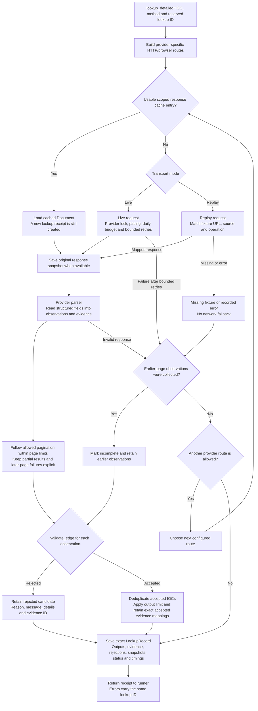
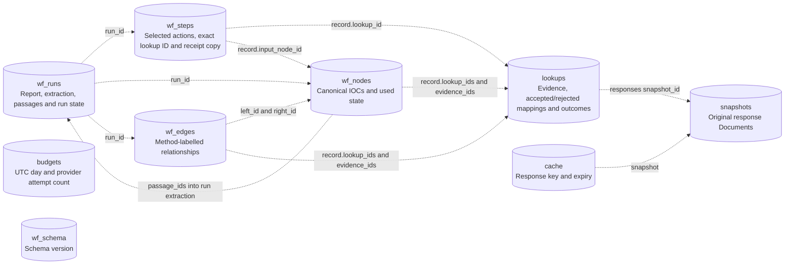

# How the implemented IOC Hunter workflow works

This describes the implementation present on 4 November 2026. The terminal
submits a report, displays extracted IOCs, accepts your IOC/method selection,
executes a lookup, validates its evidence, applies the paper's admission
condition and saves the investigation. The same saved investigation can be
reopened, inspected and exported.

The lookup is inside the workflow. Its relationship validator runs
automatically, and the runner checks the accepted evidence again before graph
admission. Selection is manual; the stored policy name is
`manual-selection/paper-admission-v1`, and method reward remains unevaluated.

## 1. Overall workflow

```mermaid
flowchart TD
    INPUT["Submit a text file, pasted report, or CSV/XLSX row"]
    CREATE["WorkflowRunner.create_run<br/>Save original report, digest, source, settings and run ID"]
    EXTRACT["extract_report<br/>Filter reference sections, split sentences, run IOCFinder"]
    NORMALIZE["Canonicalize IOC identities<br/>Preserve passages, original context and diagnostics"]
    INITIAL{"Extraction succeeded and initial nodes fit the limit?"}
    FAILED["Save failed state and diagnostics<br/>Original report remains available"]
    PUBLISH["Atomic extraction commit<br/>Save initial nodes and extraction; run becomes ready"]
    MENU["Terminal: inspect IOCs and choose a seed"]
    METHODS{"Compatible selectable method?"}
    UNSUPPORTED["Explain unavailable methods<br/>Keep IOC visible"]
    LIMITS{"Step and active-time budgets allow a lookup?"}
    CLOSED["Mark run completed with stop reason"]
    BEGIN["Atomic begin_step<br/>Reserve lookup ID, save running step, mark seed used"]
    LOOKUP["LookupClient.lookup_detailed<br/>Retrieve, parse, validate and save exact receipt"]
    VERIFY["Verify exact receipt ID, method and input<br/>Recheck finalized accepted evidence mappings"]
    USABLE{"Receipt outcome is ok, empty or partial?"}
    GATE{"Validated outputs overlap known unused IOCs?"}
    SIZE{"All proposed nodes fit the node limit?"}
    PROPOSE["Propose ALL validated outputs and supported edges<br/>Merge existing identities and provenance"]
    NOADD["No node or edge additions<br/>Retain outputs, evidence, rejections and decision"]
    COMMIT["Atomic commit_step<br/>Save graph changes, completed step, delta and new revision"]
    AGAIN{"Step or active-time limit reached?"}
    SUMMARY["Display lookup outcome, admission and graph changes"]

    INPUT --> CREATE --> EXTRACT --> NORMALIZE --> INITIAL
    INITIAL -->|No| FAILED
    INITIAL -->|Yes| PUBLISH --> MENU
    MENU --> METHODS
    METHODS -->|No| UNSUPPORTED --> MENU
    METHODS -->|Yes| LIMITS
    LIMITS -->|No| CLOSED
    LIMITS -->|Yes| BEGIN --> LOOKUP --> VERIFY --> USABLE
    USABLE -->|No: failed or interrupted| NOADD
    USABLE -->|Yes| GATE
    GATE -->|No| NOADD
    GATE -->|Yes| SIZE
    SIZE -->|No| NOADD
    SIZE -->|Yes| PROPOSE
    PROPOSE --> COMMIT
    NOADD --> COMMIT
    COMMIT --> SUMMARY --> AGAIN
    AGAIN -->|Yes| CLOSED
    AGAIN -->|No: ready| MENU
```



The menu also supports `ioc NUMBER`, `steps`, `details`, `export PATH`, `save`,
`finish` and `cancel`. `save` exits an already persisted run and leaves it ready
for further work. `finish` and `cancel` close it while keeping its results.

All usable extracted IOCs become initial nodes within the configured limit.
Hashes without lookup methods remain visible. Merely occurring in the report
does not create edges. If extraction fails or the initial node count exceeds
the limit, the run retains the report and available diagnostics as a failure.

## 2. Which code owns each responsibility

| Code | Implemented responsibility |
| --- | --- |
| `main.py` | CLI commands, input selection and dependency construction |
| `workflow/terminal.py` | Prompts, menus, result summaries and inspection commands |
| `workflow/runner.py` | Coordinate extraction, selected lookup, receipt recovery and graph commits |
| `extraction/pipeline.py` | Report filtering, sentence processing, IOC extraction and context |
| `lookup.py` | Cache, retrieval routes, retries, pagination, parsing, validation and exact receipts |
| `providers/` | RapidDNS, OTX and VirusTotal request routes and field parsing |
| `validation.py` | Check whether provider fields support exact ontology-permitted endpoints |
| `workflow/policies.py` | Apply the known-unused candidate overlap condition |
| `workflow/models.py` | Run limits and stable canonical node/edge identities |
| `workflow/repository.py` | Transactional run, step and graph persistence |
| `storage.py` | Lookup receipts, response snapshots, cache and live request budgets |
| `workflow/replay.py` | Explicit fixture transport with no network fallback |

## 3. Pseudocode for creating an investigation

The following is explanatory pseudocode for the existing functions, not another
implementation or the paper's full automatic method-selection algorithm.

```text
CREATE_RUN(report_text, source, settings):
    reject empty text, oversized text, or invalid source
    create run_id and report_id
    save original report, digest, settings and status = extracting

    extract report:
        optionally exclude reference/navigation sections
        split retained text into sentences
        find IOC matches in each sentence
        merge repeated extracted IOC identities and matching contexts

    attach stable passage IDs to the sentences
    canonicalize each extracted IOC
    retain unusable identities as diagnostics
    construct initial nodes and their passage associations

    if extraction failed or initial node count exceeds max_nodes:
        save failed state and available extraction/diagnostics
    else, in one transaction:
        save extraction, passages and initial nodes
        set run status = ready
        advance graph revision

    return the persisted run
```

## 4. What provider evidence validation means

A provider is RapidDNS, OTX or VirusTotal. Evidence is the provider record that
supports a proposed relationship: for example, a particular DNS row or a URL
field in a captured response.

For a query about `example.com`, this row supports the domain-IP relationship:

```text
hostname = example.com
record_type = A
address = 192.0.2.10
```

A row naming `sub.example.com` does not establish the same relationship for
`example.com`. The validator retains that rejected candidate and explains the
hostname mismatch.

The implemented validator checks:

1. Both IOC values normalize successfully and match the method's input/output types.
2. The ontology permits the type pair, and the result does not merely echo the input.
3. The method is implemented and the evidence matches its provider and operation.
4. The evidence identifies the exact queried IOC.
5. The evidence includes an excerpt, locator and response-body digest.
6. Relationship-specific fields support the exact endpoints.

| Relationship proof | Fields checked |
| --- | --- |
| DNS | Exact hostname, exact address, and A versus AAAA record type |
| URL host | The domain equals the URL's hostname |
| IP country | The country field is explicitly associated with the queried IP |
| URL link | Explicit outgoing-link or supported direct-redirect endpoints |

These are deterministic checks on parser-produced evidence. They establish that
the captured source fields support a connection. They do not establish
maliciousness, actor attribution or present-day truth of historical observations.

The actual invocation path is:

```text
WorkflowRunner.execute_step()
    -> LookupClient.lookup_detailed()
        -> LookupClient._run()
            -> parse_document()
            -> validate_edge() for each candidate
    -> WorkflowRunner._apply_receipt()
        -> verify exact receipt association
        -> revalidate accepted evidence mappings
        -> PaperAdmissionPolicy.evaluate()
        -> WorkflowRepository.commit_step()
```

## 5. Lookup internals and retained evidence



The receipt combines every processed candidate's outcome. Accepted and rejected
branches are per-candidate classifications, not early returns after the first
row. Pagination and route fallback run before the collected observations are
validated. Partial responses can contain useful validated outputs.

Cache hits reuse response data; they still go through parsing and validation.
Replay caches are scoped by fixture content digest and separated from live
caches. Replay requests do not consume the live provider request budget.

## 6. Pseudocode for one selected lookup step

```text
EXECUTE_STEP(run_id, input_node_id, method_id, optional step_id):
    load the saved run and verify its mode/policy
    if this exact step_id already completed:
        return the saved step without another lookup or graph commit
    reject closed runs, unfinished prior steps, or incompatible methods
    stop if step or accumulated active-time budget is exhausted

    allocate a step_id and an exact lookup_id
    in one begin_step transaction:
        save the running step and its selected IOC/method/lookup_id
        mark the selected IOC used
        set the run status = running

    receipt = lookup_detailed(input IOC, method_id, reserved lookup_id)
    on a lookup error, load its saved receipt by the same lookup_id

    verify receipt ID, method and input identity
    for each finalized accepted mapping:
        verify it references a retained output and evidence
        revalidate the evidence against the proposed endpoints

    known = IDs already in this run's graph
    used = IDs marked used, including the current IOC
    outputs = IDs with validated accepted evidence
    overlap = outputs INTERSECT (known MINUS used)

    admit = receipt outcome is ok/empty/partial AND overlap is nonempty
    reject admission if finalized accepted evidence is incomplete
    reject admission if the whole proposed batch exceeds max_nodes

    if admitted:
        propose ALL validated outputs and supported method-labelled edges
        merge contexts and evidence into any existing nodes/edges
    otherwise:
        propose no node or edge additions
        retain the receipt and admission explanation

    in one commit_step transaction:
        merge proposed graph data and evidence associations
        save completed step, exact receipt copy, outcome and graph delta
        update elapsed acquisition time and graph revision
        set run ready, or completed if a step/time limit was reached

    show the result and allow another manual selection while ready
```

The policy stores `reward = null` and `reward_status = not_evaluated`. It records
the admission decision, without implementing automatic ranking or reward counters.

## 7. Why evidence acceptance and graph admission differ

Assume the graph initially knows `A` and `B`, and the selected IOC is `A`.
Starting the step marks `A` used. The unused known set is therefore `{B}`.

| Validated outputs | Admission | Saved graph additions |
| --- | --- | --- |
| `{B, C}` | Pass: overlaps `{B}` | Add C and both A-B and A-C |
| `{C}` | Fail: no known unused match | No node/edge additions; retain C in receipt |
| `{}` when the provider only returned A | Fail; self-echo is rejected before admission | No node/edge additions |
| `{B}` after B was already used | Fail: B is no longer in the unused set | No node/edge additions |

This is the implemented candidate-overlap condition. It does not inspect graph
paths or run a cycle-detection algorithm. A newly discovered IOC becomes
selectable when an admitted batch adds it to the investigation graph.

## 8. The actual database and what it stores

There is one SQLite file per selected store directory: `lookups.sqlite3`.
`EvidenceStore` manages lookup-related tables, and `WorkflowRepository` manages
the `wf_*` tables in that same file. A graph server is not involved.

| Actual table | SQL columns | Current use |
| --- | --- | --- |
| `wf_schema` | `id`, `version` | Current workflow schema version, checked before use |
| `wf_runs` | `id`, `record` | Run status/configuration, original report, extraction, passages, diagnostics and graph revision |
| `wf_steps` | `id`, `run_id`, `sequence`, `record` | Selected IOC/method, reserved lookup ID, progress, receipt copy, outcome, admission and graph delta |
| `wf_nodes` | `run_id`, `id`, `record` | Canonical IOC nodes, context, sources, passage/evidence links, origin and used flag |
| `wf_edges` | `run_id`, `id`, `left_id`, `right_id`, `method_id`, `record` | Undirected method-labelled connections and supporting evidence links |
| `lookups` | `id`, `lookup_key`, `record`, `created` | Immutable per-call receipt: input, outputs, accepted/rejected mappings, evidence, errors and snapshot references |
| `snapshots` | `id`, `document` | Original response body and its URL, format, retrieval metadata and diagnostics |
| `cache` | `key`, `snapshot`, `expires` | Expiring pointer to a reusable response snapshot |
| `budgets` | `day`, `source`, `calls` | Live request attempts per provider and UTC day; replay bypasses it |

`record` and `document` columns contain JSON text. There are no separate report,
passage or evidence tables: reports/passages are embedded in run JSON, and
evidence is embedded in lookup receipt JSON. `wf_steps.record.lookup_id` is a
JSON field, not an additional SQL column.

The following arrows show logical references. SQL foreign-key constraints are
not declared; the repository checks references and graph endpoints in code.



Nodes are unique per `(run_id, canonical IOC identity)`. Their stable ID hashes
the canonical type/value. Edge identity hashes sorted endpoint IDs and the
method ID. Repeating a discovery merges supporting context/evidence instead of
duplicating the node or same-method edge. A reverse lookup is a separate method
and can therefore have its own labelled relationship between the same endpoints.

The response-body digest on an Evidence object and the snapshot ID are
different hashes: the first covers the body; the second covers the serialized
entire response Document.

## 9. Database transaction order and interruption recovery

The network request is outside the graph write transaction. Keeping a SQLite
write transaction open during provider requests would hold it for the request's
entire duration. The implementation instead saves a durable attempt first,
then a durable lookup receipt, then atomically applies the graph result.

```mermaid
sequenceDiagram
    participant U as Terminal
    participant R as WorkflowRunner
    participant W as WorkflowRepository
    participant L as LookupClient
    participant E as EvidenceStore
    participant P as Provider or replay transport

    U->>R: Select IOC and method
    R->>W: begin_step
    Note over W: Transaction 1: reserve lookup ID,<br/>save running step, mark seed used
    R->>L: lookup_detailed with reserved ID
    L->>E: Check scoped response cache
    alt Response must be acquired
        L->>P: Bounded request or fixture read
        P-->>L: Response or operational error
    end
    L->>E: Save available response snapshots
    Note over L: Parse fields and validate candidates<br/>Retain accepted and rejected evidence
    L->>E: Save exact lookup receipt
    L-->>R: Receipt or error carrying exact ID
    Note over R: Verify receipt; revalidate accepted evidence;<br/>evaluate overlap and node budget
    R->>W: commit_step with proposals and decision
    Note over W: Transaction 2: merge graph and provenance,<br/>complete step, update run and revision
    W-->>R: Commit delta
    R->>W: Read the persisted completed step
    W-->>R: Completed step
    R-->>U: Outcome, admission and graph-change summary
```

```text
RESUME(run_id):
    reload saved configuration and original mode
    for replay, verify that the original fixture content digest still matches
    if the run is already completed/cancelled/failed:
        return its saved state
    if extraction was interrupted:
        retain original report and mark interrupted_extraction failure
    for each unfinished lookup step:
        if its exact lookup receipt exists:
            reapply that receipt through validation/admission/atomic commit
            make no provider request
        else:
            complete the step as interrupted_unknown with no graph additions
            require another explicit manual selection to retry
    return the saved run
```

A saved failed/interrupted receipt finalizes diagnostics without graph
additions. Completed-step IDs return their saved result without duplicating
changes. An invalid receipt association or invalid accepted mapping raises an
error instead of committing graph data. This recovery works for both live and
replay runs.

## 10. Concrete result from the saved offline demonstration

The report initially produced three nodes: `example.com`, `192.0.2.10` and a
SHA256 hash. The DNS fixture returned two unique validated addresses:
`192.0.2.10` and `192.0.2.12`. A row for `sub.example.com` and `192.0.2.11` was
rejected. The known-unused `.10` address made admission pass for the batch.

The saved step delta was:

```json
{"new_nodes": 1, "new_edges": 2, "evidence_links": 3}
```

There are three evidence links because `.10` has two supporting DNS rows and
`.12` has one. The database contains four nodes, two edges, one lookup receipt
and one original response snapshot. The hash remains visible without an
implemented lookup method. The investigation remains `ready` because the
terminal command was `save`.

The example is synthetic. Its actual saved export is
`output/workflow-demo-20261104-135941/investigation.json`; its SQLite file is
`output/workflow-demo-20261104-135941/store/lookups.sqlite3`.

For commands and settings, see [the workflow guide](WORKFLOW_GUIDE.md). The
core implementation can be followed through [the runner](ioc_hunter/workflow/runner.py),
[lookup service](ioc_hunter/lookup.py), [validator](ioc_hunter/validation.py),
[policy](ioc_hunter/workflow/policies.py), [workflow repository](ioc_hunter/workflow/repository.py)
and [evidence store](ioc_hunter/storage.py).
